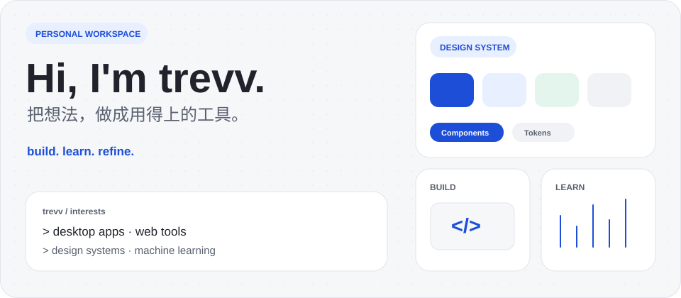
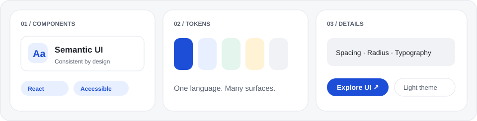
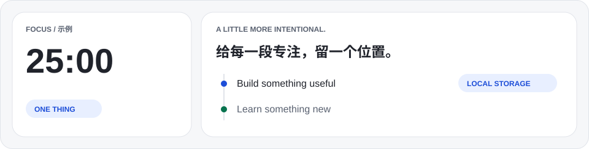

 

把日常想法做成用得上的小工具。关注桌面应用、Web 体验与设计系统，也持续整理机器学习与深度学习笔记。

### 正在打磨的作品

**[Modern AI Design System ↗](https://github.com/trevv731-hue/modern-ai-design-system)**  
跨平台设计系统，从语义主题、Design Tokens 到 React 组件、动效与无障碍规范。  
DESIGN SYSTEM · REACT · CSS

**[寸光 · Time Tracker ↗](https://github.com/trevv731-hue/cunguang-time-tracker)**  
轻量时间记录工具，用计时、分类、时间轴与统计看见时间的去向。  
WEB APP · LOCAL STORAGE

---

### 工具与学习

**[TFT Recorder ↗](https://github.com/trevv731-hue/tft-recorder)**  
云顶之弈战绩桌面助手：自动记录、数据分析与对局查询。  
DESKTOP · PYTHON · DATA

**[ML / DL Notes ↗](https://github.com/trevv731-hue/ml-dl)**  
整理机器学习与深度学习的理论基础、PyTorch 实践和数学学习资料。  
LEARNING · PYTORCH · NOTES

More things I've built

- [File Shredder](https://github.com/trevv731-hue/file-shredder) — Windows 文件粉碎与强制删除工具。
- [APKS Converter](https://github.com/trevv731-hue/APKSConverter) — Android 拆分包合并与重新签名工具。
- [openGym Pages](https://github.com/trevv731-hue/opengym-pages) — 基于 openGym 的中文健身记录本地版。

 

---

持续做东西，也持续把它们打磨得更好。 · [Explore repositories ↗](https://github.com/trevv731-hue?tab=repositories)
